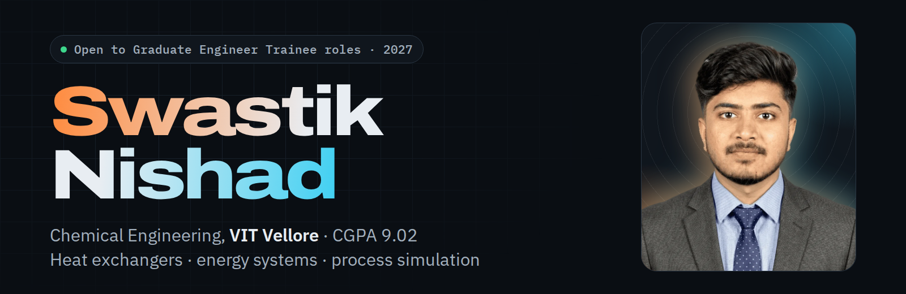

<picture>
  <source media="(prefers-color-scheme: dark)" srcset="https://raw.githubusercontent.com/swastik-2803/swastik-2803/main/banner-dark.png">
  <source media="(prefers-color-scheme: light)" srcset="https://raw.githubusercontent.com/swastik-2803/swastik-2803/main/banner-light.png">
  
</picture>

Final-year **Chemical Engineering** student at **VIT Vellore** (CGPA **9.02/10**). I design and simulate heat exchangers, process equipment and energy systems. I'm looking for **Graduate Engineer Trainee** roles for 2027 in process engineering, energy efficiency, thermal systems or process control, and I'm happy to relocate anywhere in India.

**[Portfolio website](https://swastik-2803.github.io)** · **[Resume (PDF)](https://swastik-2803.github.io/Swastik_Nishad_Resume.pdf)** · **[LinkedIn](https://www.linkedin.com/in/swastik-nishad-68a254435/)** · nishadswastik24@gmail.com

### Now

Simulating a 5 TPD biogas purification system that uses a polyacrylamide–piperazine hydrogel, in Aspen Plus V15, for my final-year project at VIT.

### Projects

Each project carries an equipment tag, the way it would appear on a process flow diagram.

| Project | Tools / codes | Highlights |
| :-- | :-- | :-- |
| `U-100` Biogas purification with a PAM–PZ hydrogel · *final-year project, in progress* | Aspen Plus V15 | 5 TPD · hydrogel separation modelled as a user-defined block |
| `E-101` Shell-and-tube ammonia cooler · *L&T EduTech* | DWSIM | NH₃ 92 → 46 °C · counter-current · LMTD, ΔP, U and area |
| `E-102` Heat exchanger energy analysis and waste heat recovery | Aspen Plus V15 | Energy balances · heat integration |
| `R-101` Jacketed CSTR: dynamic modelling and optimization | MATLAB/Simulink | Process response · optimized operating conditions |
| `T-101` CO₂ absorption column · *L&T EduTech* | DWSIM | Pressure, flow rates and column specifications |
| `TK-101` API 650 atmospheric storage tank · *L&T EduTech* | API 650 | Shell, bottom and annular plates · 1-foot method |
| `AG-101` Agitator design: pitched-blade vs hydrofoil · *L&T EduTech* | — | Reynolds number · power · pumping rate |
| `V-101` Horizontal pressure vessel on saddle supports · *L&T EduTech* | — | Zick's method |

Try the interactive model comparing counter-current and co-current flow in the [thermal lab on my portfolio](https://swastik-2803.github.io/#lab).

### Toolkit

| Area | Tools and methods |
| :-- | :-- |
| Simulation | Aspen Plus V15 · DWSIM · MATLAB/Simulink |
| Thermal & energy | Heat transfer · Heat exchanger design · Energy balances · Waste heat recovery · Heat integration · Energy utilization analysis |
| Equipment design | Storage tanks (API 650) · Agitator design · Equipment sizing · Design optimization · SolidWorks |
| Core | Process simulation · Process dynamics · Process optimization · Data analysis |

### Certification, exposure and leadership

- **Thermo-Mechanical Design and Simulation of Process Equipment**, L&T EduTech College Connect Programme · May–Jul 2026 · *First Class*
- **Core Member, Management Team**, AIChE Student Chapter, VIT
- **Industrial visit to a sewage treatment plant:** screening → grit removal → biological treatment → settling → sludge handling, with BOD, COD, TSS and pH monitoring

### Education

| Year | Qualification | Result |
| :-- | :-- | :-- |
| 2027 (expected) | B.Tech, Chemical Engineering · Vellore Institute of Technology, Vellore | CGPA 9.02/10 |
| 2022 | Higher Secondary Certificate (Science) · Narayana School, Kolkata | 91% |
| 2020 | Secondary School Certificate (Science) · Narayana School, Kolkata | 93.4% |

Languages: English, Hindi, Bengali
